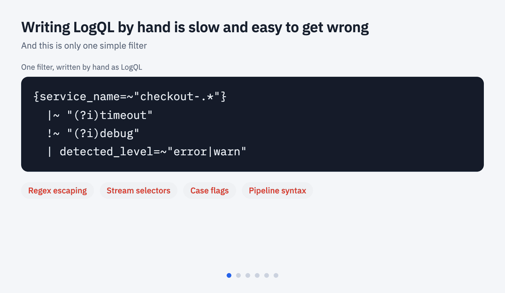

# logql-query-box

A React query box for [Grafana Loki](https://grafana.com/oss/loki/). People type a friendly search language, and you get validated [LogQL](https://grafana.com/docs/loki/latest/query/) back.

**[Try the live demo](https://darshanraj046.github.io/logql-query-box/)** in your browser, with nothing to install.

```text
level:error,warn app:checkout-* timeout -debug
```

becomes

```logql
{service_name=~"checkout-.*"}
  |~ "(?i)timeout"
  !~ "(?i)debug"
  | detected_level=~"error|warn"
```



- **Two layouts.** `classic` with chips and a run bar, or `bar`: a one line filter bar with an embedded Queries panel, made for log pages.
- **A guided flow for people who do not know LogQL or regex**: field, then an operator in plain words, then values. Repeated filters merge, and a value or pattern that matches nothing gets one-click fixes.
- **Saved queries built in** (bar): search, pinned and all saved groups, inline edit, inline delete confirm, a "Save query as" popover. You keep the API, the box calls your callbacks.
- **Suggestions** for fields, values with line counts, saved and recent queries, all keyboard driven.
- **Chips** for every condition, removable with one click.
- **Live validation** that matches what Loki really accepts, including RE2 regex rules.
- **Show LogQL** with copy buttons, one per query branch.
- **Search help** dialog, dark mode, and themable CSS variables.
- **Headless engine** with no React dependency, usable on a server.
- No runtime dependencies besides React.

## Install

```bash
npm install logql-query-box
```

Works with `yarn add` and `pnpm add` too. React 18 or newer is required.

To install directly from GitHub instead, pin a tag. The built files are committed, so there is no build step.

```bash
npm install github:darshanraj046/logql-query-box#v0.4.0
```

## Quick start

```tsx
import { LogQLQueryBox } from 'logql-query-box'
import 'logql-query-box/styles.css'

export function LogSearch() {
  return (
    <LogQLQueryBox
      values={{
        service_name: [{ value: 'checkout-api', count: 8123 }, { value: 'auth-service', count: 2210 }],
        service_category: ['JAVA', 'PYTHON']
      }}
      onExecute={({ query, logql, filter }) => {
        console.log(query)
        console.log(logql.branches)
        console.log(filter)
      }}
    />
  )
}
```

`onExecute` only fires for a valid filter. It receives:

| Field | Meaning |
| --- | --- |
| `query` | The text the user typed. |
| `logql.branches` | One LogQL string per branch. Run them all and merge the results. |
| `logql.count` | The number of branches. |
| `filter` | The same filter as a JSON tree, for backends that build their own queries. `null` when empty. |
| `tree` | The parsed condition tree. |
| `riskyRegex` | `true` when a regex here is safe on Loki but too slow to run in a browser. See [Limits](#limits). |

### Why several branches?

The compiler turns a filter into an OR of AND-branches, with one LogQL query per branch, so `(a OR b) (c OR d)` becomes four queries. Run each one with `query_range`, then merge and de-duplicate by timestamp and line. Filters that would need more than 12 queries are blocked with a message suggesting comma lists. Change the limit with `maxBranches`.

With a `parser` on the schema, an OR stays in one query whenever LogQL can express it, so there is nothing to merge, no row comes back twice, and Loki returns the order. Only an OR that mixes raw line text with a field still splits into branches, and setting `parsed: true` on the line field removes that case too. See [Logs stored as JSON](#logs-stored-as-json).

## The search language

| You type | It means |
| --- | --- |
| `timeout` | Lines containing the word, not case sensitive |
| `"connection refused"` | An exact phrase |
| `-debug` | Lines that do not contain it |
| `/\w+Exception/` | A regular expression (RE2) |
| `level:error,warn` | Field is one of these values |
| `level:error level:warn` | Same field repeated means OR |
| `-level:debug` | Exclude a value |
| `-app:a,b` | Exclude several values |
| `app:checkout-*` | Wildcard, also inside lists: `app:a-*,b` |
| `app:"my service",other` | Quote values with spaces or commas |
| `app:"build*"` | A quoted value is literal, so `*` is a plain star there |
| `a OR b`, `a AND b` | Boolean operators, uppercase. AND binds tighter |
| `level:error (timeout OR refused)` | Group with brackets |
| `-(timeout OR refused)` | Exclude a whole group |

Half typed input stays valid, so `a OR` or `level:` never shows an error while someone is still typing.

With `operator: '='`, a field name followed by one of its values but no operator, such as `level ERROR` or `level, ERROR`, is an error instead of a silent text search. The box underlines the field and offers `level = ERROR` as a one-click fix. Quote the word, `"level"`, to search the log text for it. The check only fires when the next word is a known value of that field, or the field name ends with a comma, or the field has no known values to compare with, so ordinary text such as `error app crashed` still searches the log text.

Errors point at their position. A bad pattern names the reason and the character, such as `In /time(out/, this ( is never closed (character 5).`, and unclosed quotes and brackets are located too. `analysis.errorAt` holds the range in the query, and the bar underlines it. `analysis.fix`, when present, is a corrected query.

Free text is not case sensitive. Field values are exact, so `app:Billing` and `app:billing` differ, except when the field has known values (through `values`, `loadValues` or the schema): then what was typed is folded to the known spelling. Schema fields with `lowercase: true` are lowered before compiling.

## Keyboard

| Key | Action |
| --- | --- |
| `Enter` | Run, or complete a highlighted value |
| `Ctrl+Enter` / `Cmd+Enter` | Run exactly what was typed, even when a value is highlighted |
| `Shift+Enter` | New line |
| `Tab` | Accept the highlighted suggestion |
| `Up` / `Down` | Move through suggestions |
| `Esc` | Close suggestions, then leave the box |
| `/` and `?` | Focus the box and open help, when `globalShortcuts` is on |

## Props

| Prop | Type | Default | Purpose |
| --- | --- | --- | --- |
| `value` | `string` | | Controlled query. Pair with `onChange`. |
| `defaultValue` | `string` | `''` | Initial query when uncontrolled. |
| `onChange` | `(query, analysis) => void` | | Fires on every edit. |
| `onExecute` | `(analysis) => void` | | Fires when a valid filter runs. |
| `onSave` | `(query, existing?) => void` | | Shows a save button. `existing` is set if this query is already saved. |
| `values` | `FieldValues` | | Known values per field, plain strings or `{ value, count }`. Can change at any time. |
| `loadValues` | `(field, { signal, search }) => Promise<FieldValue[]>` | | Fetches a field's values the first time someone picks one. See [Loading values on demand](#loading-values-on-demand). |
| `searchValues` | `boolean` | `false` | Calls `loadValues` again as someone types a value, with the typed text in `search`, so the server can filter fields with many values. |
| `maxSuggestions` | `number` | `100` | Most value rows shown at once. A line under the list says how many more match. |
| `schema` | `Schema` | Loki defaults | Fields and aliases. See below. |
| `engine` | `Engine` | | A ready engine. Replaces `schema`, `values`, `loadValues`, `matchCase`, `maxBranches` and `baseSelector`. |
| `matchCase` | `boolean` | `false` | Case sensitive line matching. |
| `maxBranches` | `number` | `12` | Limit on OR expansion into separate queries. |
| `baseSelector` | `Record<string, string>` | | Stream labels added to every query, such as `{ index: 'payments' }`. Can change at any time. |
| `saved` | `SavedQuery[]` | | Shown in suggestions. |
| `recent` | `string[]` | | Recent queries. When set, you own the list. |
| `recentStorageKey` | `string \| null` | `'logql-query-box.recent'` | `localStorage` key. `null` turns storage off. |
| `examples` | `string[]` | built in | The "Try" row. `[]` hides it. |
| `syntax`, `notes` | | built in | Search help content. |
| `labels` | `Partial<Labels>` | | Override any text, for translation. |
| `description` | `ReactNode \| false` | built in | Text above the box. |
| `actions` | `ReactNode` | | Extra controls in the run bar, such as a live tail button. |
| `statusText` | `ReactNode` | | Replaces the status message, for example when a time range changed. |
| `dirty` | `boolean` | `false` | Highlights Execute when something outside the filter changed. |
| `running` | `boolean` | `false` | Disables Execute while a search is in flight. |
| `disabled`, `readOnly`, `autoFocus` | `boolean` | `false` | The usual meaning. |
| `rows` | `number` | `2`, `1` for the bar | Height of the box. |
| `showHelp`, `showLogql` | `boolean` | `false` | Show the Search help link and the LogQL toggle. |
| `variant` | `'classic' \| 'bar'` | `'classic'` | `bar` is the one line filter bar with an embedded Queries panel. See [Filter bar and saved queries](#filter-bar-and-saved-queries). |
| `classNames` | `Partial<Record<LogQLQueryBoxSlot, string>>` | | Extra classes on `bar`, `field`, `input`, `queriesButton`, `queriesPanel`, `suggestions`, `run`. |
| `showQueries`, `showRun` | `boolean` | `true` | Bar only. Hide the Queries button or the Run query button. |
| `showValueCounts` | `boolean` | `true` | Show the `1,234 lines` count next to each value suggestion. Counts still decide the order. |
| `savedCount`, `savedLoading` | `number`, `boolean` | | Bar only. Count on the Queries button (defaults to `saved.length`) and a loading row. |
| `onSelectSaved`, `onPinSaved`, `onEditSaved`, `onDeleteSaved` | `(saved, pinned?) => void` | | Bar only. Each row action shows only when its callback is set. `onEditSaved` is for your own edit UI. |
| `onSaveQuery` | `({ name, query, pinned }, existing?) => unknown` | | Bar only. Save opens the built in "Save query as" popover: a name made from the filter values, a pin checkbox and a preview. Return a promise to show "Saving…", and reject it to show the error in the popover. Without it, Save calls `onSave` for your own dialog. |
| `onUpdateSaved` | `(saved, { name, query }) => unknown` | | Bar only. The edit icon turns the row into an inline name and query editor in the panel. Same promise handling as `onSaveQuery`. |
| `onCreateAlert` | `(query, saved?) => void` | | Bar only. Shows Create alert next to Save and a bell on each saved row. |
| `onSavedSearch` | `(text) => void` | | Bar only. Fires as people type in the panel search, for server side search. The list is also filtered locally. |
| `defaultLogqlOpen` | `boolean` | `false` | Start with LogQL visible. |
| `executeOnMount` | `boolean` | `false` | Run once on load. |
| `globalShortcuts` | `boolean` | `false` | Listen for `/` and `?` on the page. Off by default so a library never takes over keys unasked. |
| `theme` | `'auto' \| 'light' \| 'dark'` | `'auto'` | `auto` follows the system. |
| `className`, `style` | | | Applied to the root and the help dialog. |

## Facets and other outside controls

Use a ref to drive the box from a sidebar, a chart, or anything else. Each call edits the query text so people can see what happened, then runs it.

```tsx
const box = useRef<LogQLQueryBoxHandle>(null)

box.current?.toggleValue('detected_level', 'error')
box.current?.toggleValue('detected_level', 'debug', true)
box.current?.clearField('detected_level')
box.current?.appendTerm('service_name', ['checkout-api'])
box.current?.setQuery('level:error')
box.current?.setQuery('level:error', { run: false })
box.current?.execute()
box.current?.focus()
box.current?.getQuery()
box.current?.openQueries()
box.current?.closeQueries()
```

To mark facet checkboxes, ask the engine what is selected:

```ts
const included = engine.activeValues(query, 'detected_level')
const excluded = engine.activeValues(query, 'detected_level', true)
```

## Custom fields

The defaults match OpenTelemetry logs in Loki. Describe your own labels with a schema.

```tsx
const schema = {
  fields: {
    namespace: { label: 'Namespace', indexed: true, aliases: ['ns'] },
    pod: { label: 'Pod', indexed: true, aliases: ['p'] },
    level: { label: 'Level', indexed: false, values: ['error', 'warn', 'info'], lowercase: true, color: 'level' },
    trace_id: { label: 'Trace', indexed: false },
    line: { label: 'Content', kind: 'line', aliases: ['msg'] }
  }
}

<LogQLQueryBox schema={schema} />
```

- `indexed: true` means a Loki stream label, which goes in the `{...}` selector.
- `indexed: false` means structured metadata or an extracted label, which becomes a `| label="x"` filter.
- Exactly one field needs `kind: 'line'`. Plain words search it.
- The first alias is what the UI writes when it adds a term.
- `selectorField` picks the label used for the fallback `=~".+"` selector. It defaults to the first `baseSelector` label, then the first indexed field.
- An invalid schema throws a clear error on first render.

Other field options: `values` (a fixed list), `synonyms` (`{ prod: 'production' }`), `groups` (below), `lowercase`, `color` (`'level'`, `'hash'`, `'accent'` or a function), `hint`, `excludeHint`, `example`.

### Value groups

Different apps can store the same thing under different names. Java logs `WARN`, Python logs `WARNING`. A group makes them one value, so nobody has to know both.

```tsx
logLevel: {
  label: 'Log Level',
  aliases: ['level'],
  values: ['ERROR', 'WARN', 'WARNING', 'INFO'],
  groups: { WARN: ['WARN', 'WARNING'] }
}
```

`level:warn` and `level:warning` both compile to `| logLevel=~"WARN|WARNING"`, and `-level:warn` excludes both. Chips and facets keep what was typed. A group name does not have to be a stored value, so `groups: { problem: ['ERROR', 'FATAL'] }` adds `level:problem`.

`synonyms` map one word to one stored value. Use `groups` when one word should cover several stored values.

### Loading values on demand

Use `loadValues` when the list of values is too large or changes too often to fetch up front.

```tsx
<LogQLQueryBox
  baseSelector={{ index }}
  loadValues={async (field, { signal }) => {
    const res = await fetch(`/api/logs/values?index=${index}&field=${field}`, { signal })
    return res.json()
  }}
/>
```

- It runs the first time someone picks a value for a field, and once per field after that. Values already known through `values` stay visible until it answers.
- The result is the same shape as `values`: plain strings or `{ value, count }`. It replaces what `values` holds for that field.
- When `baseSelector` changes, the running request is aborted through `signal` and values load again for the new stream.
- If it fails, the box keeps working with what it has and tries again the next time the list opens.
- With `searchValues`, it also runs as someone types, 250 ms after they stop, with the typed text in `search` (an empty string before anything is typed). Each answer is cached per field and text, an answer that arrives after the text changed is ignored, and the box still filters what comes back.
- It does not run when you pass a ready `engine`. Headless code can do the same thing using `suggest().field`, which names the field while a value is being picked.

For a field with many values, let the server filter:

```tsx
<LogQLQueryBox
  searchValues
  loadValues={async (field, { signal, search }) => {
    const res = await fetch(`/api/logs/values?index=${index}&field=${field}&q=${encodeURIComponent(search)}&limit=100`, { signal })
    return res.json()
  }}
/>
```

### Logs stored as JSON

When logs are stored as JSON lines, their fields are not Loki labels until a parser runs, so a filter like `| logLevel="ERROR"` on its own finds nothing. Set `parser` on the schema, and use `baseSelector` for the stream labels every query must include.

```tsx
const schema = {
  parser: 'json',
  fields: {
    logLevel: { label: 'Log Level', aliases: ['level'], values: ['ERROR', 'WARN', 'INFO', 'DEBUG'] },
    serviceName: { label: 'App Name', aliases: ['app'] },
    content: { label: 'Content', kind: 'line', parsed: true, aliases: ['msg'] }
  }
}

<LogQLQueryBox schema={schema} baseSelector={{ index: 'payments' }} />
```

Now `level:error app:checkout-* timeout` compiles to:

```logql
{index="payments"}
  |~ "(?i)timeout"
  | json logLevel, serviceName, content | __error__=""
  | logLevel="ERROR"
  | serviceName=~"^(?:checkout-.*)$"
  | content=~"(?is).*timeout.*"
```

And `level:error OR timeout` stays one query:

```logql
{index="payments"}
  | json logLevel, content | __error__=""
  | logLevel="ERROR" or content=~"(?is).*timeout.*"
```

`parsed: true` says the searchable text lives in a parsed field with the same name as the line field. Without it, words search the whole raw line, keys and all, so `service` matches every row that has a `serviceName` key. The `|~` line is only a fast first pass: it lets Loki skip lines before paying for the parser, and the `content` filter decides the result.

- The parser stage is added only when a query filters on a field, and it comes after the line filters so Loki parses fewer lines. `json` extracts only the fields the query uses, which roughly halves what Loki sends back. `parser: 'logfmt'` works the same way, but extracts every field.
- `baseSelector` labels are not fields, so they never appear in suggestions or chips. Values are escaped for you. While a value is empty, the query uses `label=~".+"`.
- `baseSelector` is for building queries, not for access control. Anyone can change what a browser sends, so enforce access on your server.
- The fast first pass is left out for excluded words, regexes, and text with characters a JSON encoder may rewrite, such as quotes, backslashes, slashes or non-ASCII letters. Those searches are still correct, but Loki parses every line in the range.
- A word that also appears in every line, such as a JSON key, gets no help from the first pass either. On 1.5M lines over 24 hours, searching `service` took about 8 seconds. Narrow the time range or add a field filter.

## Without React

The engine runs anywhere, including a Node backend.

```ts
import { createEngine } from 'logql-query-box/core'

const engine = createEngine({ values: { service_name: ['checkout-api'] }, baseSelector: { index: 'payments' } })
const result = engine.analyze('level:error timeout')

result.error
result.logql.branches
result.filter
```

| Method | Purpose |
| --- | --- |
| `analyze(query)` | Parse, validate and compile in one call. |
| `validate(query)` | Returns an error string, or `''`. Handy for saved query forms. |
| `parse(query)`, `compile(tree)` | The separate steps. |
| `evaluate(tree, record)` | Test a record in JavaScript, for client side filtering or demos. |
| `suggest(query, caret, extras?)` | The suggestion list, to build your own UI. |
| `chipText(node)`, `isNegative(node)` | Chip rendering. |
| `highlightPattern(tree)` | A `RegExp` for highlighting matched text in log lines, or `null`. Leaves out risky regexes. |
| `removeNode`, `toggleValue`, `appendTerm`, `clearField`, `activeValues` | Query text editing. |
| `combine(query)` | Merges repeated filters on one field, `app != a app != b` to `app != a,b`. The LogQL does not change. |
| `replaceValue(query, field, from, to, negative?)` | Swaps one value or pattern, keeping the rest of the filter. `to` with `*` becomes a wildcard. |

`analyze()` also returns `unknownValues`: values and field patterns that match no known value of their field, each with up to three close `matches`. It is empty for fields with no known values.

## Filter bar and saved queries

`variant="bar"` renders a one line bar: a filter icon, the query, a Queries button with a count, and Run query. While closed it shows the filters on one line, joined by commas, with a fade and a "+N filters" count when they do not fit. When the text box has focus and holds a query, it grows into an editor over the page, with clear and copy buttons, and Save and Create alert under Queries. Clicking Queries opens only the panel. Known field names are highlighted while you type. Saved and recent queries leave the suggestion list because the Queries panel shows them.

The panel lists pinned queries first, then the rest, in the order you pass them. Clicking a row loads and runs it. Pin, alert, edit and delete appear on hover, each only when its callback is set. The box never calls an API itself: you fetch, update `saved`, and it re-renders.

```tsx
<LogQLQueryBox
  variant="bar"
  schema={schema}
  baseSelector={{ index }}
  saved={saved}
  savedCount={total}
  savedLoading={loading}
  onExecute={run}
  onSelectSaved={(s) => track(s.id)}
  onPinSaved={(s, pinned) => api.pin(s.id, pinned).then(reload)}
  onSaveQuery={({ name, query, pinned }, existing) => (existing ? api.update(existing.id, name, query) : api.create(name, query, pinned)).then(reload)}
  onUpdateSaved={(s, { name, query }) => api.update(s.id, name, query).then(reload)}
  onDeleteSaved={(s) => api.remove(s.id).then(reload)}
  onCreateAlert={(query, s) => openAlertDialog(query, s)}
  onSavedSearch={(text) => setSearch(text)}
/>
```

### Complete example with a REST backend

A copy-paste page: the bar, saved queries over REST, results, and highlighting. The endpoints follow the APIWiz logger API (`/v1/api-logger/application-log`). Change `API`, the headers and the paths to match yours.

```tsx
import { createEngine, LogQLQueryBox, type Analysis, type SavedQuery, type Schema } from 'logql-query-box'
import 'logql-query-box/styles.css'
import { useEffect, useMemo, useState } from 'react'

const API = '/v1/api-logger/application-log'
const headers = () => ({ 'Content-Type': 'application/json', jsessionId: sessionStorage.getItem('jsessionId') ?? '' })

async function call<T>(method: string, path: string, body?: unknown): Promise<T> {
  const res = await fetch(`${API}${path}`, { method, headers: headers(), body: body === undefined ? undefined : JSON.stringify(body) })
  if (!res.ok) throw new Error((await res.text()) || `Request failed with ${res.status}`)
  const text = await res.text()
  return (text ? JSON.parse(text) : undefined) as T
}

const schema: Schema = {
  parser: 'json',
  operator: '=',
  fields: {
    logLevel: { label: 'level', aliases: ['level'], values: ['ERROR', 'WARN', 'INFO', 'DEBUG', 'NONE'], example: 'Severity of the line. Pick one or more of ERROR, WARN, INFO, DEBUG, NONE' },
    serviceName: { label: 'app', aliases: ['app'], example: 'Service that wrote the line' },
    serviceType: { label: 'app.type', aliases: ['app.type'], values: ['JAVA', 'NODE', 'GO', 'PYTHON'], example: 'Runtime of the service' },
    content: { label: 'content', kind: 'line', parsed: true, aliases: ['content'], example: 'Text inside the line. Use * as a wildcard' }
  }
}

export function ApplicationLogs({ index, apps }: { index: string; apps: string[] }) {
  const engine = useMemo(() => createEngine({ schema, values: { serviceName: apps }, baseSelector: { index } }), [index, apps])
  const [saved, setSaved] = useState<SavedQuery[]>([])
  const [loading, setLoading] = useState(true)
  const [rows, setRows] = useState<{ id: number; content: string }[]>([])
  const [ran, setRan] = useState<Analysis | null>(null)
  const q = (params: Record<string, string | number | boolean>) => new URLSearchParams(Object.entries(params).map(([k, v]) => [k, String(v)])).toString()
  const reload = (search = '') =>
    call<SavedQuery[]>('GET', `/query?${q({ 'index-name': index, expand: true, ...(search ? { search } : {}) })}`)
      .then(setSaved)
      .finally(() => setLoading(false))

  useEffect(() => {
    reload()
  }, [index])

  const run = (analysis: Analysis) => {
    setRan(analysis)
    const end = Date.now()
    call<{ id: number; content: string }[]>('GET', `/query/search?${q({ 'index-name': index, query: analysis.logql.branches[0] ?? '', startTime: end - 86400000, endTime: end, offset: 1, pageSize: 100 })}`).then(setRows)
  }
  const mark = ran && engine.highlightPattern(ran.tree)

  return (
    <>
      <LogQLQueryBox
        variant="bar"
        engine={engine}
        saved={saved}
        savedLoading={loading}
        showValueCounts={false}
        executeOnMount
        onExecute={run}
        onSaveQuery={async ({ name, query, pinned }, existing) => {
          const body = { name, query, indexName: index, metadata: { logql: engine.analyze(query).logql.branches[0] } }
          const s = existing?.id ? await call<SavedQuery>('PUT', `/query/${existing.id}`, body) : await call<SavedQuery>('POST', '/query', body)
          if (s.id && pinned !== !!s.pinned) await call('PATCH', `/query/${s.id}/pin?pinned=${pinned}`)
          await reload()
        }}
        onUpdateSaved={(s, { name, query }) => call('PUT', `/query/${s.id}`, { name, query }).then(() => reload())}
        onPinSaved={(s, pinned) => call('PATCH', `/query/${s.id}/pin?pinned=${pinned}`).then(() => reload())}
        onDeleteSaved={(s) => call('DELETE', `/query/${s.id}`).then(() => reload())}
        onSavedSearch={(text) => reload(text)}
        onCreateAlert={(query, s) => console.log('open your alert form', query, s)}
      />
      {rows.map((r) => (
        <div key={r.id}>{mark ? r.content.split(new RegExp(`(${mark.source})`, mark.flags)).map((part, i) => (i % 2 ? <mark key={i}>{part}</mark> : part)) : r.content}</div>
      ))}
    </>
  )
}
```

Things to know when wiring it:

- Pass your own `engine` when you also call `highlightPattern`, `evaluate` or `analyze` outside the box, so both share one schema and value list.
- The callbacks may return a promise. The box shows "Saving…" or "Deleting…" while it runs and keeps the form open with the error message if it rejects, so throw an `Error` with a readable message.
- `saved` is controlled. After any change, fetch the list again and pass it back. The order you pass is the order shown, pinned first.
- Store `analysis.logql.branches[0]` next to the query text if your backend needs LogQL later, as `metadata.logql` above.
- `onCreateAlert` only reports the click. Opening and saving an alert is up to the host page.
- Saved query names should be unique per index. A duplicate name error from the API appears inside the Save popover.
- Without `onSaveQuery` or `onUpdateSaved`, Save and the edit icon call `onSave(query, existing)` and `onEditSaved(saved)`, so you can show your own dialogs instead.

### Highlighting what matched

`engine.highlightPattern(analysis.tree)` returns one `RegExp` for every text and pattern filter on the line field (`content = security`, `content = *timeout*`, `content =~ time(out|d)`, plain words), or `null`. Negated filters are left out, because they match nothing on the rows you show. Use the `analysis` from `onExecute` so the marks follow the query that ran, not the one being typed:

```tsx
const mark = analysis && engine.highlightPattern(analysis.tree)

<td>
  {mark
    ? row.content.split(new RegExp(`(${mark.source})`, mark.flags)).map((part, i) => (i % 2 ? <mark key={i}>{part}</mark> : part))
    : row.content}
</td>
```

Splitting on a capturing group puts the matched parts at the odd indexes. Pass your own `engine` to the box, or build one with `createEngine` and the same options, so both use the same schema.

### Patterns for people who do not know regex

After `app =~` the list offers three rows: *starts with* (`^`), *ends with* (`$`) and *is exactly* (`^ … $`). Each puts the caret where the text goes. While typing, a note shows which known values the pattern matches: *Matches 3 of 5: passive-scan-consumer, pii-detector, policy-evaluator*, or *Matches no app. ^ means starts with and $ means ends with*. After a run, a pattern that matches no known value gets the same fix prompt as a value, for example *Any app starting with "passive"*, which rewrites it as the wildcard `app = passive*`.

Deleting a saved query asks first, inside the row: *Delete "JVM & Node failures"?* with Delete and Cancel. `onDeleteSaved` only runs on Delete, and a rejected promise shows its message in the row.

### `field = value` syntax

Set `operator: '='` on the schema to write `level = ERROR,WARN` instead of `level:error,warn`. Both forms still parse, and everything the box writes uses the operator.

| Query | Meaning |
| --- | --- |
| `level = ERROR,WARN` | Level is ERROR or WARN |
| `level != DEBUG` | Level is not DEBUG |
| `app.type != JAVA,GO` | Exclude several values |
| `app =~ security` | Regular expression (RE2) found anywhere in the value, like grep |
| `app =~ ^(billing\|checkout)-` | Use `^` and `$` to anchor it |
| `app !~ ^pii` | Does not match the regular expression |
| `content =~ timeout\|refused` | Regular expression found anywhere in the line |
| `app = /checkout-.*/` | Slashes also mean a regular expression |
| `app.type = JAVA` | Aliases may contain dots. Loki label names still may not. |
| `content = *SocketTimeoutException*` | Line contains the text. `*` inside the text is a wildcard. |
| `content = "nearing capacity"` | Line contains the phrase |
| `level = INFO,ERROR, app = a,b` | A comma list may continue after a space or a new line, until the next field |

```ts
const schema: Schema = {
  parser: 'json',
  operator: '=',
  fields: {
    logLevel: { label: 'level', aliases: ['level'], values: ['ERROR', 'WARN', 'INFO', 'DEBUG', 'NONE'], example: 'Log level: ERROR, WARN, INFO, DEBUG, NONE' },
    serviceName: { label: 'app', aliases: ['app'], example: 'App that wrote the log line' },
    serviceType: { label: 'app.type', aliases: ['app.type'], values: ['JAVA', 'NODE', 'GO', 'PYTHON'], example: 'Runtime: JAVA, NODE, GO, PYTHON' },
    content: { label: 'content', kind: 'line', parsed: true, aliases: ['content'], example: 'Text in the log line, use * as wildcard' }
  }
}
```

The `example` text is the hint shown next to each field in the suggestion list.

The suggestion list walks people through a filter one step at a time, so nobody needs to know LogQL or regex:

1. **Field.** `level`, `app`, `app.type`, `content`, each with its hint.
2. **Operator, in plain words.** For `app`: *is one of the values you pick* (`=`), *is not one of the values you pick* (`!=`), *contains some text, or matches a pattern* (`=~`), *does not contain the text or match the pattern* (`!~`).
3. **Value.** Known values that start with the typed text, then values that contain it. If the typed text is not an exact value, a last row offers `*text*`, *every app containing "text"*. For `content` and for `=~` there is nothing to pick, so a short note says what to type.
4. Picking a value goes straight back to the field list for the next filter. Tab and Enter accept the highlighted row at every step.

When the query runs:

- Repeated filters on the same field are merged in the text. `app != policy-evaluator app != pii` becomes `app != policy-evaluator,pii`. The LogQL is the same either way.
- If a value matches no known value, a line under the bar says so and offers one-click fixes: *No app is exactly "pii", so nothing was excluded. Did you mean:* `pii-detector`, *Every app containing "pii"*. It only appears for fields with known values (`values`, `loadValues` or the schema), and disappears as soon as the query is edited.

The engine exposes the same pieces for your own UI: `analysis.unknownValues`, `engine.combine(query)` and `engine.replaceValue(query, field, from, to, negative)`.

## Theming

Every color and font is a CSS variable on `.lqb`. Set them in your own stylesheet.

```css
.lqb {
  --lqb-accent: #7c3aed;
  --lqb-accent-soft: #f3e8ff;
  --lqb-font-ui: Inter, sans-serif;
  --lqb-font-mono: 'JetBrains Mono', monospace;
}
```

The bar adds its own variables on `.lqb-v-bar`:

```css
.lqb-v-bar {
  --lqb-bar-height: 40px;
  --lqb-bar-radius: 6px;
  --lqb-bar-bg: #f8fafc;
  --lqb-bar-bg-open: #fff;
  --lqb-field-color: #1d4ed8;
  --lqb-op-color: #64748b;
  --lqb-count-bg: #e2e8f0;
  --lqb-panel-width: 440px;
}
```

All class names start with `lqb-`, and the stylesheet does not touch anything outside the component. For anything a variable does not cover, add your own class through `classNames` or target the `lqb-` classes.

### Writing your own CSS

The stylesheet is a separate import. Leave out `import 'logql-query-box/styles.css'` and nothing is styled, so your own CSS has nothing to fight. Behaviour does not depend on it, apart from the rules below that make the bar work.

| Class or attribute | Element |
| --- | --- |
| `.lqb.lqb-v-bar` | Root of the bar variant |
| `.lqb-bar-row` | The bar and the Run query button |
| `.lqb-bar-slot` | Holds the space of one closed line. The bar sits on top of it |
| `.lqb-bar`, `[data-open]`, `[data-invalid]` | The bar. `data-open` while editing a query, `data-invalid` on a syntax error |
| `.lqb-field`, `.lqb-funnel`, `.lqb-edit`, `.lqb-field-acts` | Input area, filter icon, editor, clear and copy |
| `.lqb-hl`, `.lqb-hl-f`, `.lqb-hl-op` | Highlight layer under the transparent textarea, field names, operators |
| `.lqb-qside`, `.lqb-qbtn`, `.lqb-count`, `.lqb-qside-acts`, `.lqb-side-btn` | Queries button, count badge, Save and Create alert |
| `.lqb-run`, `.lqb-run-idle` | Run query |
| `.lqb-sugg`, `.lqb-sg-h`, `.lqb-sg`, `[aria-selected='true']`, `.lqb-hint`, `.lqb-sg-note` | Suggestion list, headers, rows, the active row, right hand hint, note |
| `.lqb-qpanel`, `.lqb-q-search`, `.lqb-q-list`, `.lqb-q-item`, `.lqb-q-main`, `.lqb-q-name`, `.lqb-q-acts` | Queries panel |
| `.lqb-error` | Syntax error message |

Rules your CSS must keep for the bar: `.lqb-hl` and the textarea need the same font, size, line height and padding so the colours line up with the caret, and the textarea text stays `color: transparent`. `.lqb-sugg` and `.lqb-qpanel` are `position: fixed` popovers placed by the component. They live in the browser top layer, so they are never clipped, but they are still inside `.lqb` and inherit its variables and your selectors.

By default the open editor floats over the page instead of pushing it down. To push content down instead:

```css
.lqb-bar-slot { height: auto; }
.lqb-bar { position: relative; }
```

## Upgrading from 0.5.0 or 0.5.1

- `SavedQuery.id` is a `string` again, as in 0.4. 0.5.0 and 0.5.1 widened it to `string | number`, which broke type checks in apps that pass `saved.id` to functions taking a `string`. If your backend returns numeric ids, map them with `String(id)`.
- Error messages for bad patterns changed from "One of the /regular expressions/ is not valid." to a specific reason and position. Code that compared the exact text needs updating. `engine.validate()` keeps its short messages.
- In `=` mode, `level ERROR` is now an error with a fix instead of a text search for both words.

## Upgrading from 0.4

- Value suggestions now show at most 100 rows, with a "N more" line under them. Pass `maxSuggestions` to change that. `engine.suggest()` is unchanged unless you pass `limit` in its extras, and then returns `more` with the count left out.
- `loadValues` receives `search` too. It is `''` unless `searchValues` is on, so existing loaders keep working.

## Upgrading from 0.3

- `showHelp` and `showLogql` now default to `false`. Pass them to keep the Search help link and the Show LogQL toggle.
- Nothing else changes for the classic layout or the default `:` syntax. Compiled LogQL is identical, which the prototype parity and real Loki tests check.
- To move to the new look, add `variant="bar"`, and `operator: '='` on the schema for `level = ERROR` style queries. Old saved queries in `:` syntax still parse in `=` mode.

## What Loki taught this library

Generated queries are tested against a real Loki server, which surfaced behavior that is easy to get wrong.

- **Selectors must be able to exclude the empty string.** Loki rejects `{app=~".*"}`, and also `{app=~"(foo)?"}` and `{app!="x"}`. The compiler tests each pattern against the empty string and adds a safe selector when needed, so `app:*` just works.
- **Label filters need explicit anchors.** A pipeline filter such as `| level=~"e.*"` can match `debug`, because Loki may optimize it into a substring check. The compiler always writes `^(?:e.*)$` for pipeline regexes.
- **Row order depends on the response format.** Without `X-Loki-Response-Encoding-Flags: categorize-labels`, Loki groups rows by every parsed field, so a `| json` query can return one group per row and rows arrive out of time order. Send that header from your backend. Each stream is still its own group, so this gives one ordered list only when one stream holds the logs. Loki can split a busy stream on its own, which shows up as a `__stream_shard__` label.
- **Structured metadata does not sort anything.** Loki orders rows by timestamp only, and without that header each set of metadata values is also its own group.
- **RE2 is not JavaScript.** `(?P<x>a)` is valid RE2 and invalid JavaScript, while `\y` is the reverse. Validation follows RE2, and it is checked against the Go parser that Loki uses.

## Limits

- **Risky regexes do not run in the browser.** Loki uses RE2, which stays fast on any pattern. The JavaScript regex engine can stall on patterns such as `(a+)+b`, even on a short line, and it cannot be interrupted. These patterns are detected first: `evaluate()` does not apply that condition, `highlightPattern()` leaves it out, and `analysis.riskyRegex` is `true`. The query still compiles and runs on Loki as normal. The check is cautious, so a few harmless patterns are skipped too, such as `(a+b)+`. Use `isRiskyRegex(pattern)` to ask the same question in your own code.
- `evaluate()` runs on the JavaScript regex engine after translating RE2 syntax. Flags set in the middle of a pattern, such as `a(?i)b`, are validated but not applied there. Loki itself handles them correctly, so only client side filtering is affected.
- `level:none` in the default schema compiles to `detected_level="unknown"`. Loki fills `detected_level` only when `discover_log_levels` is on, which is its default, and then gives `unknown` to lines with no level it can find. `evaluate()` sees only the fields in the records you pass it, so for client side filtering include `detected_level` in each record, or map `none` to a value your logs carry through `synonyms`, or use your own level field.
- Only the first 50 chips are shown, followed by a count of the rest. The filter still uses every term.
- The component builds queries. Running them, time ranges and results are yours, which keeps it usable with any backend.

## Development

```bash
npm install
npm run dev
npm test
npm run check
```

`npm run dev` opens a demo. The test suite has several layers:

| Layer | What it proves |
| --- | --- |
| `test/prototype-parity.test.ts` | Thousands of random queries behave the same as the original implementation, kept in `test/oracle`. |
| `test/fixes.test.ts` | Every intentional difference from that implementation, showing both the old and the new result. |
| `test/regex.test.ts` | Regex validation agrees with Go `regexp/syntax` on over 20,000 patterns. |
| `test/regex-safety.test.ts` | Every regex judged safe finishes quickly on worst case input, checked in a sandbox that can stop it. |
| `test/contrast.test.ts` | Text colors meet WCAG AA in both themes. |
| `test/invariants.test.ts` | Properties that must hold for any input, including garbage. |
| `test/component.test.tsx` | The React component, with real keyboard and mouse events. |
| `test/ssr.test.tsx` | Rendering with no browser globals. |
| `test/e2e.loki.test.ts` | For random queries, real Loki returns exactly the rows `evaluate()` picks, for label based logs and for JSON lines. |

To run the Loki tests, start a local Loki and point the tests at it:

```bash
loki -config.file=test/loki/loki-test.yaml -config.expand-env=true
```

```bash
npm run test:loki
```

`npm run golden` refreshes the recorded RE2 verdicts, which needs Go installed.

`npm run record` rebuilds `docs/demo.gif` from the real component. Start `npm run dev` first. It needs Chrome and ffmpeg installed.

## License

MIT
